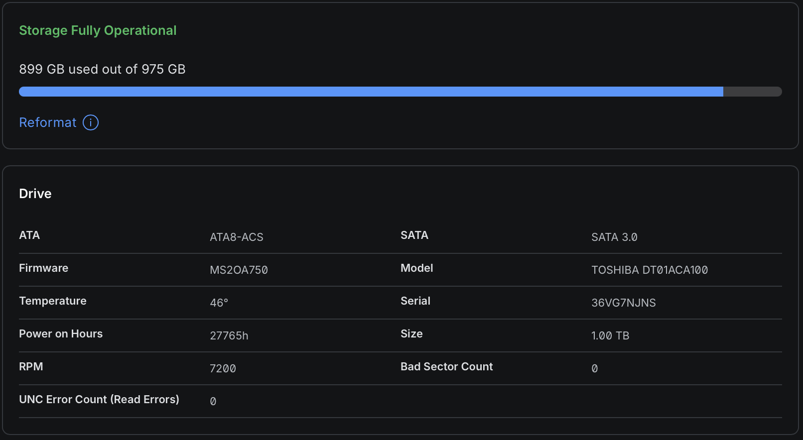

# Week 3 – Estimating Embodied Emissions

**Author:** Žiga Rogelj (GitHub: Zigia)
**Date:** 27 October 2026

Conversion factor for electricity, as given in the task: **0.235 kg CO2e/kWh** (CEU IJS, 2023, https://ceu.ijs.si/izpusti-co2-tgp-na-enoto-elektricne-energije/). Yearly energy use is carried over from my week 2 lab notes.

**Embodied emissions** = production + transport (end-of-life excluded, < 1 % everywhere).

## Data sources and why I chose them

| Device | Embodied kg CO2e | Source | Why this source |
|--------|------------------|--------|-----------------|
| iPhone 13 Pro 512 GB | 77 | Apple Product Environmental Report, Sept 2021: 88 kg life cycle, 84 % production + 3 % transport | Manufacturer LCA, ISO 14040/14044, per storage configuration. Best available data, but it is Apple's own scoping. |
| MacBook Air M2 256 GB | 113 | Apple PER, June 2022: 147 kg life cycle, 69 % production + 8 % transport | Same as above. |
| HomePod 2 | 60 | Apple PER, Jan 2023: 92 kg life cycle, 64 % production + 1 % transport | Same as above. |
| UniFi U6 Pro | ~70 (*est.*) | Ubiquiti publishes no LCA. Cisco's ISO-aligned LCAs for two comparable Wi-Fi 6/6E access points: CW9171I (0.96 kg) – 76 kg manufacturing + 17 kg transport; CW9166I (1.6 kg) – ~92 kg manufacturing. Scaled by weight to the U6 Pro (~0.76 kg) → ~74 kg; rounded down to 70 kg because Ubiquiti ships by sea rather than Cisco's air-freight assumption. | Same product class, same component mix (PCB, radios, PoE, die-cast/plastic housing); two independent data points agree within 20 %. |
| Toshiba 1 TB HDD | ~20 (*est.*) | Toshiba publishes no LCA. Tannu & Nair (2023), who compiled 24 HDD LCA reports from four vendors, give **20 kg CO2e embodied for a 1 TB HDD** (vs. 160 kg for a 1 TB SSD). Seagate's own 3.5" reports (e.g. Enterprise Capacity 10 TB: 2.6 kg CO2e/TB-year incl. use) are consistent with this. | Peer-reviewed meta-analysis across vendors; HDD manufacturing is very similar between Toshiba, Seagate and WD (same platters, motors, PCBs). |
| 2 × Shelly Plus 2PM | ~6 (*est.*, 3 each) | Shelly publishes no LCA. Pirson & Bol (2021) bottom-up LCA of IoT edge devices: simple sensor node (Philips Hue occupancy sensor) ≈ 1.4 kg; Wi-Fi smart-home device with a small SoC (Google Home mini) 3.8 / 7.3 / 14.9 kg (low / typical / high). A Shelly Plus 2PM (ESP32 SoC, 2 relays, power-metering IC, ~40 g, no speaker/mics) sits between the two → ~3 kg each. | Peer-reviewed, bottom-up (component-level) method built exactly for this class of device. |

---

## 1. iPhone 13 Pro 512 GB

Yearly energy use: **5.5 kWh** → 1.3 kg CO2e/year. Embodied: **77 kg CO2e**.

| Time span | Energy use | CO2e from energy use | Embodied (total) | Embodied per year | Use : embodied |
|---|---|---|---|---|---|
| 1 year | 5.5 kWh | 1.3 kg CO2e | 77 kg CO2e | 77.0 kg CO2e | 2 % |
| 3 years | 16.5 kWh | 3.9 kg CO2e | 77 kg CO2e | 25.7 kg CO2e | 5 % |
| 5 years | 27.5 kWh | 6.5 kg CO2e | 77 kg CO2e | 15.4 kg CO2e | 8 % |
| 10 years | 55.0 kWh | 12.9 kg CO2e | 77 kg CO2e | 7.7 kg CO2e | 17 % |

I have owned it 5 years with two battery replacements; use would need ~60 years to equal manufacturing.

## 2. MacBook Air M2

Yearly energy use: **13.3 kWh** → 3.1 kg CO2e/year. Embodied: **113 kg CO2e**.

| Time span | Energy use | CO2e from energy use | Embodied (total) | Embodied per year | Use : embodied |
|---|---|---|---|---|---|
| 1 year | 13.3 kWh | 3.1 kg CO2e | 113 kg CO2e | 113.0 kg CO2e | 3 % |
| 3 years | 39.9 kWh | 9.4 kg CO2e | 113 kg CO2e | 37.7 kg CO2e | 8 % |
| 5 years | 66.5 kWh | 15.6 kg CO2e | 113 kg CO2e | 22.6 kg CO2e | 14 % |
| 10 years | 133.0 kWh | 31.3 kg CO2e | 113 kg CO2e | 11.3 kg CO2e | 28 % |

Break-even: ~36 years.

## 3. HomePod (2nd gen)

Yearly energy use: **9.9 kWh** → 2.3 kg CO2e/year. Embodied: **60 kg CO2e**.

| Time span | Energy use | CO2e from energy use | Embodied (total) | Embodied per year | Use : embodied |
|---|---|---|---|---|---|
| 1 year | 9.9 kWh | 2.3 kg CO2e | 60 kg CO2e | 60.0 kg CO2e | 4 % |
| 3 years | 29.7 kWh | 7.0 kg CO2e | 60 kg CO2e | 20.0 kg CO2e | 12 % |
| 5 years | 49.5 kWh | 11.6 kg CO2e | 60 kg CO2e | 12.0 kg CO2e | 19 % |
| 10 years | 99.0 kWh | 23.3 kg CO2e | 60 kg CO2e | 6.0 kg CO2e | 39 % |

Break-even: ~26 years – even an always-on speaker is dominated by manufacturing, thanks to its 1 W low-power mode.

## 4. UniFi U6 Pro access point

Yearly energy use: **74.5 kWh** → 17.5 kg CO2e/year. Embodied: **~70 kg CO2e** (*est.* from Cisco access-point LCAs).

| Time span | Energy use | CO2e from energy use | Embodied (total) | Embodied per year | Use : embodied |
|---|---|---|---|---|---|
| 1 year | 74.5 kWh | 17.5 kg CO2e | 70 kg CO2e | 70.0 kg CO2e | 25 % |
| 3 years | 223.5 kWh | 52.5 kg CO2e | 70 kg CO2e | 23.3 kg CO2e | 75 % |
| 5 years | 372.5 kWh | 87.5 kg CO2e | 70 kg CO2e | 14.0 kg CO2e | 125 % |
| 10 years | 745.0 kWh | 175.1 kg CO2e | 70 kg CO2e | 7.0 kg CO2e | 250 % |

Break-even: ~4 years. Installed 4.66 years ago → 82 kg CO2e of use so far, i.e. use has just overtaken manufacturing (1.2×).

## 5. Toshiba 1 TB HDD for NAS/NVR

Yearly energy use: **52.6 kWh** → 12.4 kg CO2e/year. Embodied: **~20 kg CO2e** (Tannu & Nair 2023, 1 TB HDD).

| Time span | Energy use | CO2e from energy use | Embodied (total) | Embodied per year | Use : embodied |
|---|---|---|---|---|---|
| 1 year | 52.6 kWh | 12.4 kg CO2e | 20 kg CO2e | 20.0 kg CO2e | 62 % |
| 3 years | 157.8 kWh | 37.1 kg CO2e | 20 kg CO2e | 6.7 kg CO2e | 185 % |
| 5 years | 263.0 kWh | 61.8 kg CO2e | 20 kg CO2e | 4.0 kg CO2e | 309 % |
| 10 years | 526.0 kWh | 123.6 kg CO2e | 20 kg CO2e | 2.0 kg CO2e | 618 % |

Break-even: ~1.6 years. The drive's SMART counter shows 3.17 years = 167 kWh = 39 kg CO2e already – 2× its manufacturing.

## 6. 2 × Shelly Plus 2PM

Yearly energy use: **17.5 kWh** → 4.1 kg CO2e/year. Embodied: **~6 kg CO2e** (*est.* from Pirson & Bol 2021, 3 kg per unit).

| Time span | Energy use | CO2e from energy use | Embodied (total) | Embodied per year | Use : embodied |
|---|---|---|---|---|---|
| 1 year | 17.5 kWh | 4.1 kg CO2e | 6 kg CO2e | 6.0 kg CO2e | 69 % |
| 3 years | 52.5 kWh | 12.3 kg CO2e | 6 kg CO2e | 2.0 kg CO2e | 206 % |
| 5 years | 87.5 kWh | 20.6 kg CO2e | 6 kg CO2e | 1.2 kg CO2e | 343 % |
| 10 years | 175.0 kWh | 41.1 kg CO2e | 6 kg CO2e | 0.6 kg CO2e | 686 % |

Break-even: ~1.5 years. Installed 3 years ago → 12 kg CO2e of use, already 2× manufacturing.

---

## Summary

| Device | kWh/year | Use kg CO2e/year | Embodied kg CO2e | Break-even (years) | Use : embodied after 5 years |
|--------|----------|------------------|------------------|--------------------|------------------------------|
| iPhone 13 Pro | 5.5 | 1.3 | 77 | ~60 | 8 % |
| MacBook Air M2 | 13.3 | 3.1 | 113 | ~36 | 14 % |
| HomePod 2 | 9.9 | 2.3 | 60 | ~26 | 19 % |
| UniFi U6 Pro | 74.5 | 17.5 | ~70 | ~4.0 | 125 % |
| Toshiba 1 TB HDD | 52.6 | 12.4 | ~20 | ~1.6 | 309 % |
| 2 × Shelly Plus 2PM | 17.5 | 4.1 | ~6 | ~1.5 | 343 % |
| **Total** | **173.3** | **40.7** | **~346** | | |

## Reflections

The devices split into two groups with opposite rules.

**Group 1 – personal Apple devices (iPhone, MacBook, HomePod):** manufacturing dominates completely. The break-even point where use-phase emissions would equal embodied emissions is 26–60 years, far beyond any realistic lifespan. Whatever I do with charging or settings changes the footprint by at most a few percent; the only lever that matters is *how many years I keep the device* – the embodied 77 kg of the iPhone drops from 77 kg/year to 15 kg/year by keeping it 5 years instead of 1, and the two battery replacements that made that possible cost a few kg each. For this group, "sustainable computing" means repair and longevity, not efficiency.

**Group 2 – always-on infrastructure (access point, hard disk, Shelly relays):** the rule flips. The hard disk and the relays have small embodied footprints (6–20 kg) and run 8 760 hours a year, so use overtakes manufacturing within 1.5 years and after 5 years is 3–3.5× larger. The access point is heavier (~70 kg embodied, similar to a HomePod) but at 8.5 W continuous it still breaks even after 4 years – which it reached this year. All three have passed the point where use dominates. Here longevity does *not* help – keeping an inefficient 24/7 device longer makes it worse – and the lever is the opposite: switch it off when not needed, consolidate, or replace it with a lower-idle design (e.g. Zigbee/Thread relays at < 0.1 W instead of Wi-Fi relays at 1 W would pay back their embodied carbon in under a year).

The data quality follows the same split: Apple publishes ISO-14040 LCAs per configuration, while Ubiquiti, Toshiba and Shelly publish nothing, so I borrowed from the best comparable sources – Cisco's LCAs for two access points of the same class (scaled by weight), a peer-reviewed meta-analysis of 24 HDD LCAs, and a bottom-up IoT device LCA. Apple's figures are the more precise, but also the ones where the company controls the scoping; for the infrastructure devices a 2× error in my estimates would move the break-even by a year or two but would not change the conclusion, because the use-phase term grows without limit.

## Sources

- CEU IJS, CO2 emissions per unit of electricity in Slovenia (0.235 kg CO2e/kWh): https://ceu.ijs.si/izpusti-co2-tgp-na-enoto-elektricne-energije/
- Apple Product Environmental Reports: iPhone 13 Pro (Sept 2021), MacBook Air M2 (June 2022), HomePod 2nd gen (Jan 2023): https://www.apple.com/environment/
- Cisco, ISO-aligned LCA reports for CW9171I and CW9166I access points: https://www.cisco.com/c/dam/en_us/about/csr/environmental-sustainability/cisco-iso-aligned-lca-report-cw9171i-public.pdf and …-cw9166i-public.pdf
- Tannu, S. & Nair, P. J. (2023). The Dirty Secret of SSDs: Embodied Carbon. HotCarbon / arXiv:2207.10793 (1 TB HDD ≈ 20 kg CO2e, from 24 vendor LCA reports)
- Seagate, Enterprise Capacity 3.5" HDD sustainability report (2.6 kg CO2e/TB-year): https://www.seagate.com/content/dam/seagate/migrated-assets/www-content/global-citizenship/_shared/product-sustainability/enterprise-cap-3-5-hdd/ent-cap-3-5-helium.pdf
- Pirson, T. & Bol, D. (2021). Assessing the embodied carbon footprint of IoT edge devices with a bottom-up life-cycle approach. *Journal of Cleaner Production*, 322, 128966 (arXiv:2105.02082)
- Week 2 lab notes (energy use per device)
- Lecture 2–3 slides, Sustainable Computing, UL FRI (Scope 1/2/3, embodied emissions)
